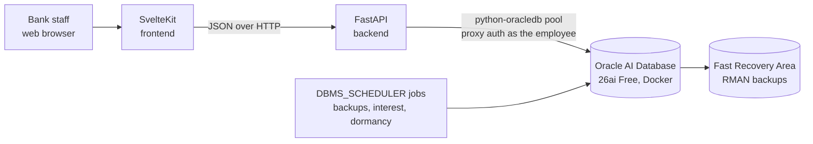

# WEL Bank — core banking back-office

Internal banking software for **WEL Bank**, a fictional Ghanaian bank. It started as my IPMC Ghana Database Technology semester-2 project (2024, a PyQt6 desktop app) and is being rebuilt as a web application on a production-style Oracle setup.

> **Status: v2 (web) in progress.** The original desktop app (v1) is kept in [`legacy/desktop-pyqt6/`](legacy/desktop-pyqt6/) and tagged `v1.0-desktop`.

## What v2 will do

- **Staff back-office:** customer onboarding with KYC, account opening with maker-checker approval, teller deposits, withdrawals and transfers on a double-entry ledger, loans from application to repayment schedule, card lifecycle, and HR management.
- **Real database security:** every employee is an Oracle user. The web app connects through **proxy authentication**, so Oracle roles (not just the app) decide what each person can do.
- **Backup and recovery:** ARCHIVELOG mode and RMAN (weekly full, daily incremental), restore scripts that have actually been tested, an admin page showing backup status, and Flashback.
- **Encryption at rest** with Transparent Data Encryption (TDE).

## Architecture (planned)



| Layer | Technology | Why |
|---|---|---|
| Database | Oracle AI Database 26ai Free (official Docker image) | Latest free Oracle release; includes RMAN, Flashback and TDE |
| Business rules | PL/SQL packages | Every client must follow the same rules; nobody bypasses them |
| Backend | Python, FastAPI, `python-oracledb` (thin mode) | Typed JSON API; official Oracle driver with no client install |
| Frontend | SvelteKit | Simple component model |
| Tooling | uv, Ruff, pytest, pre-commit, gitleaks | Reproducible installs, consistent style, no leaked secrets |

## Repository layout

```text
.
├── compose.yaml             The database container (Oracle 26ai Free) and its volumes
├── .env.example             Optional, non-secret settings for compose.yaml
├── database/
│   └── container/
│       ├── setup/           Run once when the database is created (FRA, WELBANK PDB)
│       └── startup/         Run on every container start (none yet)
├── scripts/
│   └── init-secrets.sh      Creates random passwords in ./secrets/ (gitignored)
├── legacy/desktop-pyqt6/    Frozen v1 desktop app (reference only), with screenshots
├── CONTRIBUTING.md          Workflow, commit messages, code style, secrets rule
└── (planned) backend/  frontend/
```

## Documentation

This repository holds the code, configuration and scripts. The detailed project documentation (design, limitations register, engineering log, guides) is maintained separately, outside the repo. In here you will find:

- this README: overview and, soon, setup;
- [CONTRIBUTING.md](CONTRIBUTING.md): how work is committed and the code style;
- docstrings and comments in the code itself;
- [legacy/desktop-pyqt6/README.md](legacy/desktop-pyqt6/README.md): the original desktop app.

## Getting started

Prerequisites: Docker with Compose, `pre-commit` and `gitleaks` (Node.js 24 LTS and `uv` come into play with the backend and frontend).

```bash
git clone https://github.com/elomwarren/welbank-core-banking.git
cd welbank-core-banking
pre-commit install            # activate the checks that run before each commit
./scripts/init-secrets.sh     # create random passwords in ./secrets/ (never committed)
docker compose up -d          # start the database
docker compose logs -f db     # first start builds the database (10-20 min); wait for "DATABASE IS READY TO USE!"
```

What you get: Oracle AI Database 26ai Free with every tablespace encrypted (TDE), ARCHIVELOG mode, a Fast Recovery Area on its own volume, and the `WELBANK` pluggable database. It listens on `127.0.0.1:1521` only.

| Task | Command |
|---|---|
| SQL*Plus as SYSDBA (no password, inside the container) | `docker exec -it welbank-db sqlplus / as sysdba` |
| Connect to WELBANK from your laptop | service name `WELBANK` on `localhost:1521` |
| Stop cleanly (SHUTDOWN IMMEDIATE) | `docker compose stop` |
| Start again | `docker compose start` |
| Status and health | `docker compose ps` |
| Delete everything, including backups | `docker compose down -v` |

Optional settings (port, recovery-area size, image) go in a `.env` file; see `.env.example`.

## Roadmap

- [x] Review the legacy app and document its limitations
- [x] Design schema v2 (staff side, Tier 1)
- [x] Restructure the repository and add tooling
- [x] Oracle 26ai Free in Docker: TDE on every tablespace, ARCHIVELOG, Fast Recovery Area, WELBANK PDB
- [ ] Schema v2 Tier 1 and seed data
- [ ] Roles, profiles, proxy authentication, Unified Auditing, TDE
- [ ] Backup and recovery: RMAN, scheduler jobs, practised restore
- [ ] FastAPI backend
- [ ] SvelteKit frontend
- [ ] Production deployment on a dedicated server (HTTPS, no database port exposed, off-server backups)
- [ ] Customer portal (phase 3)

## Author

Elom Kodjoh-Kpakpassou ([@elomwarren](https://github.com/elomwarren)), IPMC Ghana Database Technology programme.

## Licence

Not chosen yet. Until a licence file is added, the default copyright rules apply (all rights reserved).
