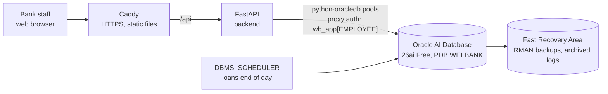

# WEL Bank — core banking back-office

Internal banking software for **WEL Bank**, a fictional Ghanaian bank. It started as my IPMC Ghana Database Technology semester-2 project (2024, a PyQt6 desktop app) and has been rebuilt as a web application on a production-style Oracle setup.

> **Status: v2 (web) complete for the staff back-office.** The original desktop app (v1) is kept in [`legacy/desktop-pyqt6/`](legacy/desktop-pyqt6/) and tagged `v1.0-desktop`.

## What v2 does

- **Staff back-office:** customer onboarding with Bank of Ghana KYC (simulated NIA Ghana Card check and sanctions screening), account opening with maker-checker approval, teller deposits, withdrawals and transfers on a double-entry ledger, reversals, loans from application and credit decision to disbursement, repayments and Bank of Ghana classification, management reports.
- **Rules in the database:** PL/SQL packages, SQL domains, check constraints and 26ai SQL assertions enforce the business rules, so no client can bypass them; a materialized view refuses any commit where debits and credits differ.
- **Real database security:** every employee is an Oracle user with the roles of their job. The web app holds no privileges of its own: it connects through **proxy authentication** as the logged-in employee, so Oracle grants, limits and auditing apply to the real person. Nobody can insert, update or delete table rows directly; only the packages write.
- **Auditing:** an immutable audit trail (five-year retention) written by the packages, plus Oracle Unified Auditing of logons, account changes, schema changes and every read of identity data.
- **Encryption and recovery:** Transparent Data Encryption on every tablespace, ARCHIVELOG mode, RMAN backups logged in the database and shown in the app, a restore drill that deletes and recovers a datafile, restore points and Flashback.
- **Realistic data:** a deterministic seed of 2,000 customers shaped by Ghana's 2021 census, 162 employees in 21 branches and two years of activity, all loaded through the packages.

## Architecture



| Layer | Technology | Why |
|---|---|---|
| Database | Oracle AI Database 26ai Free (official Docker image, pinned) | Latest free Oracle release; RMAN, Flashback, TDE, SQL assertions |
| Business rules | PL/SQL packages (definer's rights) | Every client follows the same rules; nobody bypasses them |
| Schema changes | Liquibase through SQLcl | Versioned, repeatable, reviewable migrations with rollbacks |
| Backend | Python, FastAPI, `python-oracledb` (thin mode) | Typed JSON API; official Oracle driver with no client install |
| Frontend | SvelteKit (Svelte 5), static single-page app | Simple component model; served by Caddy with the API on the same origin |
| Tooling | uv, Ruff, pytest, npm, pre-commit, shellcheck, gitleaks | Reproducible installs, consistent style, no leaked secrets |

## Repository layout

```text
.
├── compose.yaml             Database (Oracle 26ai Free); API and web under the "app" profile
├── compose.prod.yaml        Production overrides: no database port, HTTPS, secure cookies
├── .env.example             Optional, non-secret settings for compose.yaml
├── database/                See database/README.md
│   ├── container/setup/     Run once when the database is created (FRA, WELBANK PDB, bootstrap)
│   ├── bootstrap/           Schema owner, deployment account, documents tablespace (SYSDBA)
│   ├── changelog/           Liquibase changelogs; code/ holds packages, views and grants
│   ├── security/            Roles, password profile, WB_APP, audit policies, employees' users (SYSDBA)
│   ├── seed/                Synthetic, census-shaped data: generator, monthly simulation, sources
│   ├── tests/               Database tests (*_test.sql) and their runner
│   └── tools/               liquibase.sh and sql-session.sh, run inside the container
├── backend/                 FastAPI application (app/), tests, Dockerfile
├── frontend/                SvelteKit application (single-page app)
├── deploy/                  Caddyfile and the web image's Dockerfile
├── scripts/                 Everyday commands (table below)
├── legacy/desktop-pyqt6/    Frozen v1 desktop app (reference only), with screenshots
└── CONTRIBUTING.md          Workflow, commit messages, code style, secrets rule
```

## Documentation

This repository holds the code, configuration and scripts. The project documentation (report, user guide, setup, architecture, security, backup and recovery, Oracle guide, design, limitations register, engineering log, presentation) is maintained separately, outside the repo. In here you will find this README, [CONTRIBUTING.md](CONTRIBUTING.md), the folder READMEs, docstrings and comments in the code, and the interactive API documentation at `/api/docs` when the API runs.

## Getting started

Prerequisites: Docker with Compose, `pre-commit` and `gitleaks`; for development also `uv` and Node.js 24.

```bash
git clone https://github.com/elomwarren/welbank-core-banking.git
cd welbank-core-banking
pre-commit install               # checks that run before each commit
./scripts/init-secrets.sh        # random passwords in ./secrets/ (never committed)
docker compose up -d             # start the database
docker compose logs -f db        # first start builds it (10-20 min): wait for "DATABASE IS READY TO USE!"
./scripts/db-security.sh         # roles, password rules, WB_APP, audit policies
./scripts/db-migrate.sh update   # create the schema with Liquibase
./scripts/db-seed.sh             # optional: 2,000 customers and two years of activity (about 90 min)
./scripts/db-security.sh         # again: one Oracle user per employee
docker compose --profile app up -d --build   # the web app on http://127.0.0.1:8080
```

Log in with an employee's database user name (for example `AADONGO`, a teller at Accra Central, or `AOSEI`, its branch manager) and the development password in `secrets/staff_demo_pwd.txt`. Five wrong passwords lock an account for 15 minutes.

What you get: Oracle AI Database 26ai Free with every tablespace encrypted (TDE), ARCHIVELOG mode, a Fast Recovery Area on its own volume, and the `WELBANK` pluggable database. Its tables belong to `WELBANK`, a schema-only account that cannot log in; changes are applied by `WB_DEPLOY` through proxy authentication. The database listens on `127.0.0.1:1521` only, and not at all in production.

| Database task | Command |
|---|---|
| Changes not applied yet / preview their SQL | `./scripts/db-migrate.sh status` / `update-sql` |
| Apply pending changes | `./scripts/db-migrate.sh update` |
| What has been applied / undo the last change | `./scripts/db-migrate.sh history` / `rollback-count 1` |
| Run the database tests (rolled back; nothing left behind) | `./scripts/db-test.sh` |
| Roles, profiles, WB_APP, audit policies, employees' users (safe to repeat) | `./scripts/db-security.sh` (`--reset-passwords` to reset the development password) |
| Re-create / re-sync the owner and deployment accounts (safe to repeat) | `./scripts/db-bootstrap.sh` |
| Load the synthetic data (empty database only) | `./scripts/db-seed.sh` |
| Back up: full, incremental, logs, check, keystore, status | `./scripts/db-backup.sh level0` / `level1` / `archivelog` / `validate` / `keystore` / `status` |
| Practise a datafile restore (safe: uses its own tablespace) | `./scripts/db-restore-drill.sh` |
| Restore points and Flashback of WELBANK | `./scripts/db-restore-point.sh create NAME` / `list` / `drop NAME` / `flashback NAME --yes` |

| Application task | Command |
|---|---|
| Develop: API on :8000 with reload, web on :5173 | `./scripts/app-dev.sh` |
| Backend tests and lint | `cd backend && uv run pytest` (Ruff runs in pre-commit) |
| Frontend checks and build | `cd frontend && npm run check && npm run build` |
| Run the app in containers | `docker compose --profile app up -d --build` |
| Production on a server (HTTPS) | `docker compose -f compose.yaml -f compose.prod.yaml --profile app up -d --build` |
| API documentation | `http://127.0.0.1:8000/api/docs` (development) |

| Other task | Command |
|---|---|
| Interactive SQL in WELBANK (SQLcl, no password to type) | `./scripts/db-sql.sh` (or `root`, or `deploy` to act as the schema owner) |
| SQL*Plus as SYSDBA (no password, inside the container) | `docker exec -it welbank-db sqlplus / as sysdba` |
| Stop cleanly (SHUTDOWN IMMEDIATE) / start again | `docker compose stop` / `docker compose start` |
| Status and health | `docker compose ps` |
| Delete everything, including backups | `docker compose down -v` |

Optional settings (ports, recovery-area size, image) go in a `.env` file; see `.env.example`.

## Roadmap

- [x] Review the legacy app and document its limitations
- [x] Design schema v2 (staff side, Tier 1)
- [x] Restructure the repository and add tooling
- [x] Oracle 26ai Free in Docker: TDE on every tablespace, ARCHIVELOG, Fast Recovery Area, WELBANK PDB
- [x] Schema migrations with Liquibase; schema-only owner; SQL domains and reference tables
- [x] People and KYC: employees, customers, Ghana Card verification records, addresses, contacts, next of kin, photos and signatures; automated database tests
- [x] Accounts and the double-entry ledger: joint holders, maker-checker, reversals; cross-table rules as SQL assertions, debits = credits checked at COMMIT
- [x] Loans (Ghana Reference Rate pricing, Bank of Ghana classes), debit cards (no card numbers stored), maker-checker queue, immutable audit trail
- [x] Posting, onboarding and loan packages, with reconciliation and statement views
- [x] Seed data mirroring Ghana's population (GSS 2021 census): 2,000 customers, 21 branches, two years of activity, all loaded through the packages
- [x] Roles by job, password profile, proxy authentication, Unified Auditing
- [x] Backup and recovery: RMAN scripts logged in the database, nightly loans job, practised datafile restore, restore points and Flashback
- [x] FastAPI backend: every request as the employee, server-side sessions, tests
- [x] SvelteKit frontend for every role
- [x] Containers and production configuration (Caddy with HTTPS, no database port exposed)
- [ ] More packages: account servicing (freeze, close, interest on savings), HR
- [ ] Branch-level row security (Virtual Private Database)
- [ ] Deployment on a dedicated server with off-server backups
- [ ] Customer portal (phase 3)

## Author

Elom Kodjoh-Kpakpassou ([@elomwarren](https://github.com/elomwarren)), IPMC Ghana Database Technology programme.

## Licence

Not chosen yet. Until a licence file is added, the default copyright rules apply (all rights reserved).
