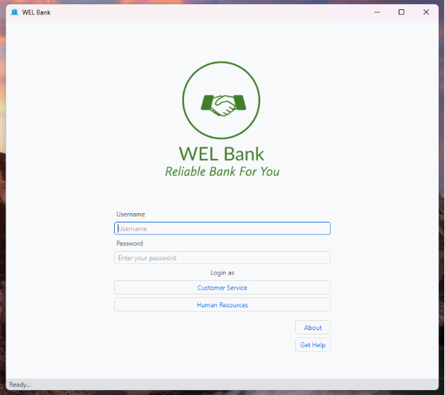
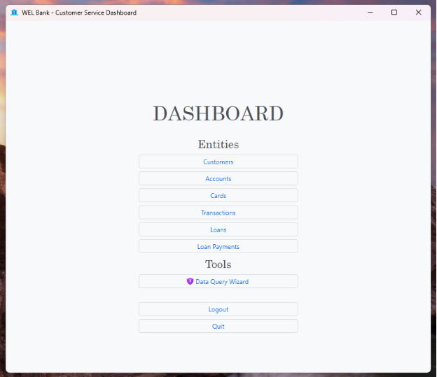
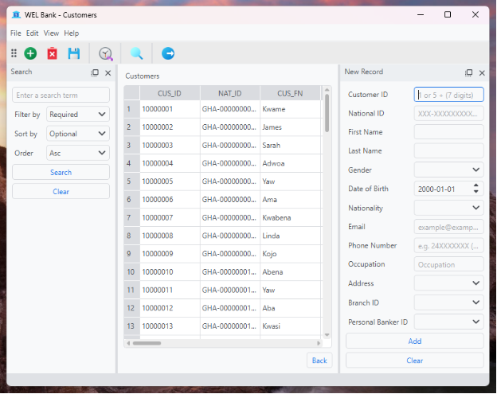
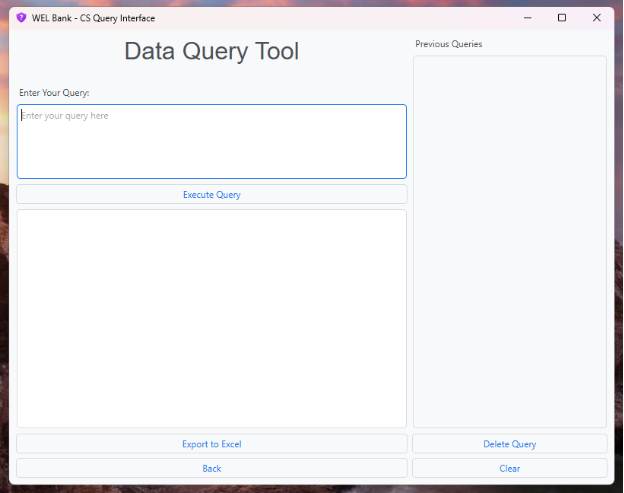

# Legacy: WEL Bank desktop app (v1, 2024)

Internal management software for a bank, built for the IPMC Ghana Database Technology semester-2 project with **Python, PyQt6 and Oracle Database 18c XE** (`cx_Oracle` driver) on Oracle Linux 7.

> **Frozen.** This folder is kept for reference and is not developed further. It is excluded from linting and formatting. The only changes since v1 are this README and **removing secrets**: `config.ini` became `config.example.ini`, and the SQL scripts now prompt for passwords. The untouched original is git tag `v1.0-desktop`.
>
> Its known problems (51, with IDs) are tracked in the project's limitations register, kept with the project documentation outside this repo. The web version (v2) replaces it.

## Features

- Customer management (registration, details)
- Accounts, cards, transactions, loans and loan payments
- Employee management (HR)
- Free-form SQL query tool with Excel export
- Separate dashboards for Customer Service and Human Resources

## Screenshots









## How it was run

Requirements: Oracle Database 18c or later with a pluggable database named `WELBANK`, and Python 3.12 with `PyQt6`, `cx_Oracle`, `pandas` and `openpyxl`.

1. In SQL*Plus, as SYSDBA, run the scripts in `sql/` in order: `SQLScript1_DatabaseCreation.sql` → `SQLScript2_Data_Input.sql` → `SQLScript3_DatabaseAccessRules.sql`. SQL*Plus asks for each `&password`. Known issue: script 2 fails on `employees` (13 values for a 14-column table, see B-03).
2. Copy `config.example.ini` to `config.ini` and fill in the host and password.
3. From this folder:

   ```bash
   python -m venv .venv && . .venv/bin/activate && pip install -r requirements.txt
   python win_01_WelcomeLogin.py
   ```

## Original limitations (from the 2024 README)

- Save and Rollback are decorative; each insertion is committed automatically.
- Delete does not work.
- Recorded transactions do not change account balances.
- Loan payments do not change the loan balance.

## File map

| File | Window |
|---|---|
| `win_01_WelcomeLogin.py` | Login (entry point) |
| `win_02_1_CusServDashboard.py` / `win_02_2_HRDashboard.py` | Department dashboards |
| `win_02_3_QueryInterface_CS.py` / `_HR.py` | SQL query tool |
| `win_03_1_1_CusTable.py` | Customers window **and** the `entityWindow` base class used by every table window |
| `win_03_1_2` … `win_03_1_6` | Accounts, Cards, Transactions, Loans, Loan payments |
| `win_03_2_1` … `win_03_2_6` | Employees, Jobs, Departments, Branches, Locations, Regions |
